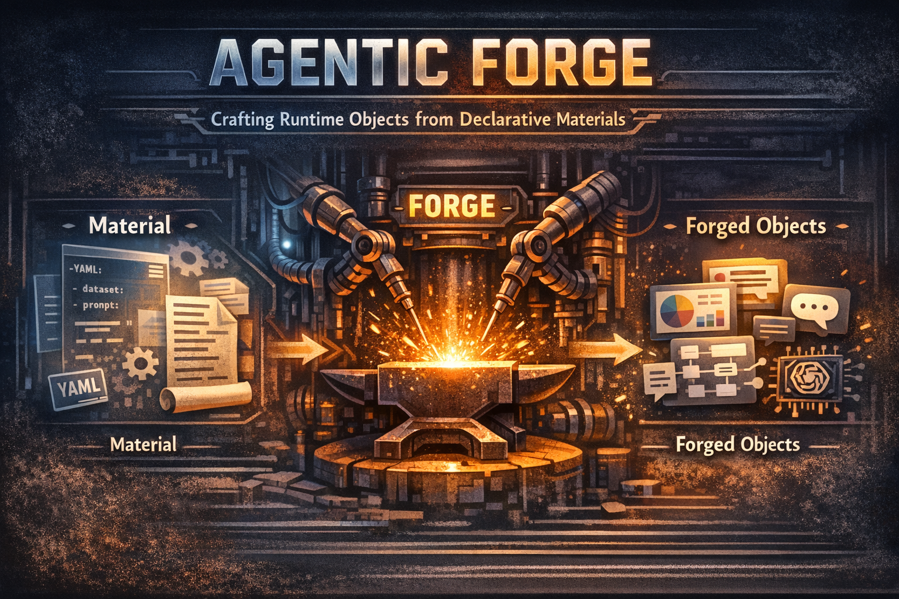

# Agentic Forge

Agentic Forge is a small declarative runtime for agentic AI components and workflows. It is designed to describe the runtime objects used by agent systems, such as prompts, tools, datasets, structured outputs, model managers, and runners, and to turn them into ready-to-use Python objects through the `material -> forge -> forged` pattern.



## Quick Start

Clone the repository, create a virtual environment, and install the dependencies:

```bash
git clone <repo-url>
cd agentic_forge2
python -m venv .venv
```

Activate the virtual environment:

```bash
# Windows PowerShell
.venv\Scripts\Activate.ps1

# macOS / Linux
source .venv/bin/activate
```

Install the runtime dependencies:

```bash
python -m pip install --upgrade pip
pip install -r requirements.txt
```

Run everything from the repository root. The examples and notebooks already resolve the local package path automatically, so no editable install step is required.

## The Forge Abstraction

Agentic Forge is built around three concepts:

- `Material`: a declarative input model, usually loaded from YAML and validated with Pydantic.
- `Forge`: a builder that knows how to read one material type and turn it into a runtime object.
- `Forged`: the runtime object produced by the forge.

The public entrypoint is intentionally small:

```python
from agentic_forge import forge

prompt = forge("examples/chat_prompt/materials/chat_prompt.yaml")
```

The `forge(...)` function:

1. loads the YAML file;
2. resolves nested `ref` blocks;
3. looks up the requested forge through the `forge` key;
4. builds the matching material;
5. returns the forged runtime object.

## YAML As A Declarative Language

The repository treats YAML as a lightweight declarative language for wiring components together.

Every material starts with a `forge` key and then declares only the fields that belong to that forge:

```yaml
forge: chat_prompt
name: vision_prompt
messages:
  - role: system
    content: You are a helpful assistant.
  - role: placeholder
    content: history
  - role: human
    content: "{user_input}"
    images:
      - "{image_path}"
```

Materials can also be composed with `ref`:

```yaml
forge: chat_prompt
name: vision_prompt_composed
messages:
  - ref: ./chat_message.yaml
  - role: placeholder
    content: history
  - ref: ./chat_message_static.yaml
```

This is the core idea of Agentic Forge: configuration stays declarative, reusable, and easy to inspect, while the Python layer stays focused on runtime behavior.

## Built-In Components

The repository already ships with native materials, forges, and forged runtime objects for:

- core forge primitives
- chat prompt composition
- response schemas
- structured output chains
- tools and toolsets
- datasets
- data runners
- LLM providers and managers

These are the built-in components documented in the example folders linked below.

## The `examples/` Folder

The examples folder is organized so that each built-in component has its own self-contained mini area:

- `README.md`: explains what the component does and which files matter.
- `quickstart.ipynb`: a short guided walkthrough with Markdown explanations and runnable code cells.
- `materials/`: YAML files and any local inputs used by the example.
- `assets/`: images or binary assets, only when needed.

There is also an index in [examples/README.md](examples/README.md).

## Native Component Guides

- [Core](examples/core/README.md)
- [Chat Prompt](examples/chat_prompt/README.md)
- [Response Schema](examples/response_schema/README.md)
- [Structured Output](examples/structured_output/README.md)
- [Tools](examples/tools/README.md)
- [Dataset](examples/dataset/README.md)
- [Data Runner](examples/data_runner/README.md)
- [LLM](examples/llm/README.md)

## Repository Layout

- [`agentic_forge/`](agentic_forge): the runtime package.
- [`examples/`](examples/README.md): component guides, materials, and quickstarts.
- [`repo_asset/`](repo_asset): repository-level assets such as the cover image.
- [`requirements.txt`](requirements.txt): runtime dependencies for the repo.
